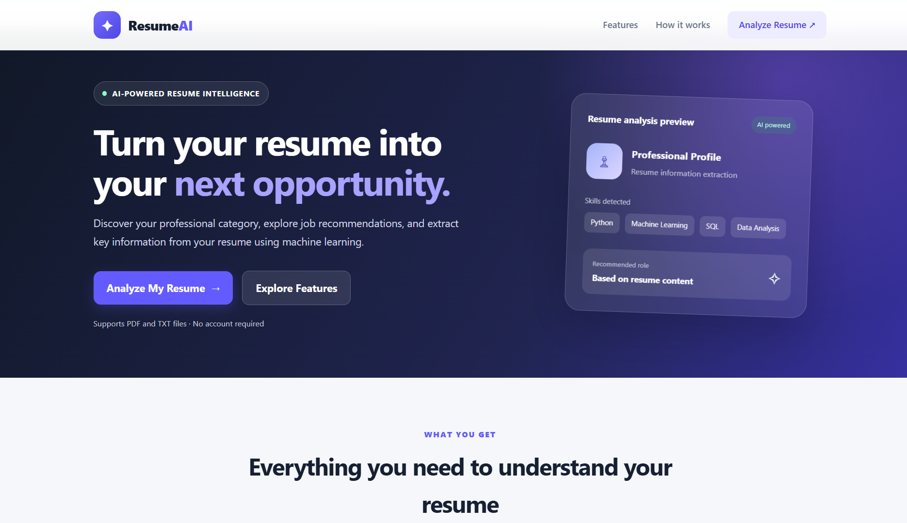

# Resume Screening & Job Recommendation System

An end-to-end Machine Learning application that analyzes resumes, predicts professional categories, recommends relevant job types, and extracts key candidate information through an interactive web interface built with FastAPI.

<p align="center">
  
  
  
  
  
  
  
  
  
  
</p>

---


---

<p align="center">
  
</p>

---


## Overview

The Resume Screening & Job Recommendation System automates parts of the initial resume review process using Natural Language Processing (NLP) techniques and traditional Machine Learning models.

Users can upload a selectable-text PDF or TXT resume and receive a predicted professional category, a recommended job type, and extracted candidate information.

### Key Features

- **Resume Upload:** Supports PDF and TXT files.
- **Resume Categorization:** Predicts a professional category using TF-IDF features and a trained Random Forest classifier.
- **Job Recommendation:** Predicts a suitable job type using a separate TF-IDF vectorizer and Random Forest classifier.
- **Candidate Information Extraction:** Extracts names, email addresses, and phone numbers using pattern-based methods.
- **Skills Detection:** Identifies skills using a curated keyword dictionary.
- **Education Detection:** Extracts education-related terms using predefined keywords.
- **Interactive Web Interface:** Displays predictions and extracted information through HTML templates rendered with Jinja2.
- **Health Endpoint:** Reports application and model availability through `/health`.
- **API Documentation:** Provides interactive API documentation through FastAPI's Swagger UI.

> **Responsible use:** This application is an assistive screening tool, not an automated hiring decision-maker. Predictions may be inaccurate and must be reviewed by qualified humans. Evaluate model performance and potential bias before using it in recruitment workflows.

## Technology Stack

| Category | Technologies |
|---|---|
| Programming Language | Python |
| Backend Framework | FastAPI |
| ASGI Server | Uvicorn |
| Machine Learning | scikit-learn, Random Forest |
| Text Feature Extraction | TF-IDF |
| Document Processing | PyPDF2 |
| Data Processing | pandas, NumPy |
| Frontend | HTML5, CSS3, JavaScript |
| Template Engine | Jinja2 |
| Development Environment | Jupyter Notebook, IPython |
| Version Control | Git, GitHub |

## How It Works

1. **Upload:** The user submits a PDF or TXT resume through the web interface.
2. **Text Extraction:** Text is extracted from the uploaded document.
3. **Text Preprocessing:** Resume text is cleaned by removing URLs, selected social tags, punctuation, non-ASCII characters, and excess whitespace.
4. **Feature Extraction:** The cleaned text is transformed into numerical features using the relevant TF-IDF vectorizer.
5. **Category Prediction:** A trained Random Forest classifier predicts the professional category.
6. **Job Recommendation:** A second TF-IDF and Random Forest pipeline predicts a recommended job type.
7. **Information Extraction:** Regular expressions and curated keyword lists identify contact details, skills, and education-related terms.
8. **Results Display:** Predictions and extracted information are presented on the results page.

## Project Structure

```text
smart_resume_ML/
├── app.py
├── requirements.txt
├── .gitignore
│
├── models/
│   ├── rf_classifier_categorization.pkl
│   ├── tfidf_vectorizer_categorization.pkl
│   ├── rf_classifier_job_recommendation.pkl
│   └── tfidf_vectorizer_job_recommendation.pkl
│
├── templates/
│   └── resume.html
│
├── static/
│   └── js/
│       └── script.js
│
├── data/                         # Excluded from Git
│
├── Extracted Info and hiring process.ipynb
├── Resume Catogorization prediction.ipynb
└── Resume Job Recommendation System.ipynb
```

**Note:** The `data/` directory is excluded from version control because it contains large datasets. Obtain the required datasets separately if you want to reproduce model training. The pre-trained model files must be available in `models/` for the application to perform predictions.

## Getting Started

### Prerequisites

- Python 3.10 or newer
- Git
- The four pre-trained model files in the `models/` directory
- The dependencies listed in `requirements.txt`

### 1. Clone the Repository

```bash
git clone https://github.com/milan-7417/smart_resume_ML.git
cd smart_resume_ML
```

### 2. Create a Virtual Environment

**Windows PowerShell**

```powershell
python -m venv .venv
.venv\Scripts\Activate.ps1
```

**macOS/Linux**

```bash
python3 -m venv .venv
source .venv/bin/activate
```

### 3. Install Dependencies

```bash
python -m pip install --upgrade pip
python -m pip install -r requirements.txt
```

Ensure the installed scikit-learn version is compatible with the version used to create the serialized model files. For reproducible environments, pin the dependency versions used during development and training.

### 4. Verify the Model Files

Confirm that the following files exist:

```text
models/rf_classifier_categorization.pkl
models/tfidf_vectorizer_categorization.pkl
models/rf_classifier_job_recommendation.pkl
models/tfidf_vectorizer_job_recommendation.pkl
```

If any model file is missing, restore it from a trusted backup or retrain the relevant model.

### 5. Run the Application

Start the development server:

```bash
python -m uvicorn app:app --reload
```

Alternatively, if `app.py` includes a suitable `uvicorn.run()` entry point:

```bash
python app.py
```

Open the application in your browser:

- **Web Interface:** http://127.0.0.1:8000/
- **Swagger API Documentation:** http://127.0.0.1:8000/docs
- **Health Check:** http://127.0.0.1:8000/health

## API Endpoints

| Method | Endpoint | Description |
|---|---|---|
| `GET` | `/` | Renders the resume upload interface. |
| `GET` | `/health` | Reports application and model availability. |
| `POST` | `/predict` | Processes an uploaded resume and renders the results. |

### `GET /health`

The endpoint reports whether the application and required models are available. A healthy response may look like:

```json
{
  "status": "healthy",
  "models_loaded": true
}
```

The actual response depends on the implementation and whether all required models loaded successfully.

### `POST /predict`

Submit a multipart form containing a file in the `resume` field.

**Supported formats:**

- `.pdf` — text extracted using PyPDF2.
- `.txt` — text decoded from the uploaded file.

The endpoint renders the results in the web interface. File validation, error handling, and response status codes depend on the implementation in `app.py`.

## Model Artifacts

| Model Artifact | Purpose |
|---|---|
| `tfidf_vectorizer_categorization.pkl` | Transforms resume text for category prediction. |
| `rf_classifier_categorization.pkl` | Predicts the professional category. |
| `tfidf_vectorizer_job_recommendation.pkl` | Transforms resume text for job recommendation. |
| `rf_classifier_job_recommendation.pkl` | Predicts the recommended job type. |

These serialized artifacts are loaded by the application. Only load pickle files from trusted sources, as loading untrusted pickle files can execute malicious code. Models saved with incompatible library versions may generate warnings, fail to load, or behave unexpectedly.

## Research & Development

The project includes Jupyter notebooks for model development and experimentation:

- `Resume Catogorization prediction.ipynb` — resume categorization.
- `Resume Job Recommendation System.ipynb` — job recommendation.
- `Extracted Info and hiring process.ipynb` — information extraction and hiring-process exploration.

To launch Jupyter Notebook:

```bash
python -m pip install jupyter
jupyter notebook
```

The large datasets under `data/` are not included in the Git repository. Reproducing training therefore requires obtaining the original datasets separately.

## Limitations

- Image-only and scanned PDFs are not supported unless OCR is added.
- Name, phone, skills, and education extraction use heuristics and may produce missing or incorrect results.
- Keyword-based extraction may miss uncommon skills and education terms.
- Prediction quality depends on the training data, preprocessing consistency, and model performance.
- The current application should not be assumed to provide authentication, persistent storage, audit logging, or production-grade upload security.
- Resumes contain personal information. Use appropriate privacy, access, and retention controls when testing or deploying the application.

## Future Improvements

- Add OCR support for scanned resumes.
- Evaluate models using suitable classification and ranking metrics.
- Expand and maintain skills and education dictionaries.
- Add automated tests for upload handling, extraction, predictions, and model loading.
- Introduce file-size limits, authentication, rate limiting, and secure deployment configuration.
- Evaluate model fairness and performance across representative candidate groups.
- Provide explainability and clear reasons for recommendations where feasible.

## Contributing

Contributions are welcome.

1. Fork the repository.
2. Create a feature branch.
3. Make focused changes.
4. Test the relevant workflows.
5. Submit a pull request describing the changes and validation performed.

---

<p align="center">
  <strong>Resume Screening & Job Recommendation System</strong><br>
  Built with Python, Machine Learning, and FastAPI.
</p>
